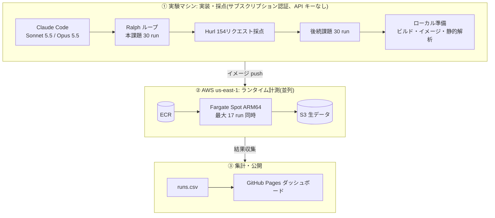
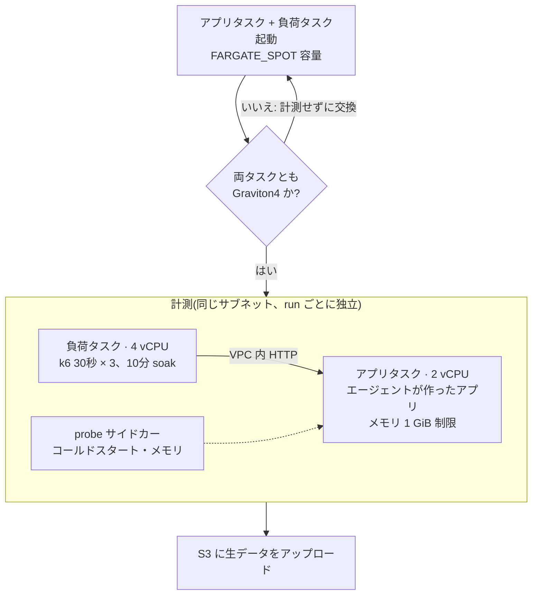

# Language Benchmark

🌐 [English](README.md) · [한국어](README.ko.md) · [日本語](README.ja.md) · [中文](README.zh-CN.md)

このプロジェクトは、**コーディングエージェント(Claude Code)が同じ RealWorld バックエンドを TypeScript、Python、Go、Rust、C++ で実装した結果を比較し、バイブコーディングのバックエンドにどの言語が適しているかを判断する。** 言語ランタイム自体の純粋な性能ベンチマークではない。測定対象はエージェントが書いたコードであり、結果には言語の特性とエージェントの実装上の選択が混ざっている。

**📊 ライブダッシュボード**: https://roboco.io/language-benchmark/

## 方法

- **固定条件**: モデル・ハーネスは Claude Code + Sonnet 5.5 と Claude Code + Opus 5.5 の2組み合わせ。どちらも Claude のサブスクリプション認証で実行し、API キー課金はない(下の「実験パイプライン」を参照)。課題は [RealWorld バックエンド](tasks/realworld-backend/)、DB は全言語で SQLite。
- **比較軸**: 実装言語5種と言語別スタック(TypeScript Fastify+Prisma、Python FastAPI+SQLAlchemy、Go Gin+GORM、Rust Axum+SQLx、C++ Drogon)。
- **作る過程の指標**: 実装時間、失敗を含むコスト(API 単価換算、請求額ではない)、反復回数、人の介入回数、実装の安定性(同条件3回の合格率)。
- **成果物の指標**: ランタイム速度(RPS・レイテンシ)、メモリ(アイドル・最大 RSS)、ランタイムの安定性(エラー率・長時間負荷でのメモリ増加)、コード量・依存数、ビルド時間・イメージサイズ・コールドスタート、依存の脆弱性、保守性(機能追加の後続課題)。
- **合格条件**: `start.sh` で起動したサーバーと `Dockerfile` でビルドしたコンテナの両方が Hurl 154 リクエストをすべて通過すること。
- ルールと根拠: [設計文書](docs/superpowers/specs/2026-10-17-language-benchmark-design.md)、[実験品質ルール](docs/experiment-quality-rules.md)(韓国語)、[指標スキーマ](analysis/metrics/SCHEMA.md)、[ロードマップ](ROADMAP.md)。

姉妹リポジトリ [coding-agent-benchmark](https://github.com/roboco-io/coding-agent-benchmark) は言語を TypeScript に固定してモデル・ハーネスの組み合わせを比較している。このリポジトリはその運用方法をそのまま使い、比較軸だけを言語に変えた。

## 実験パイプライン: API 課金なし、ランタイム計測は並列で

1回の実験でエージェント run 60個(本課題 30 + 機能追加の後続課題 30)とランタイム計測 30件を実行する。そのままではコストと時間がかかるため、2つの方法で減らした。エージェントの実装は Claude のサブスクリプション認証で実行し、API キー課金をなくした。ランタイム計測は AWS Fargate Spot の複数タスクで同時に実行し、待ち時間を短くした。

### サブスクリプション認証で API コスト 0

エージェント run はすべて Claude Code をサブスクリプション認証で実行した。実験前のスモークテストで `apiKeySource: none` を確認し、API キーが使われないことを検証した。この実験で API キーとして請求された金額はない。ダッシュボードと報告書の `cost_usd` は、トークン使用量に公開 API 単価を掛けた **API 価格換算の推定値**である。言語間のコストを同じ基準で比べるために計算した値で、実際の請求額ではない。EXP-001 全体(Phase 0・本課題・後続課題)の換算推定の累計は $40.39 だった。サブスクリプションには利用上限があるため、ハーネスは上限に達した run を保留し、最初から再実行するようにした。EXP-001 では一度も上限に達しなかった。

### Fargate Spot 並列計測で時間を短縮

事前登録の設計は、実験マシンのローカル Docker で run を1つずつ順に計測する方式だった。この方式は run あたり約13分かかり、30 run で約6.5時間が必要だった。実験者の判断で計測環境を Fargate Spot に移し、run ごとに独立したタスクのペアを起動して同時に計測した。その結果、ローカル準備とネットワークエラーによる 6 run の再計測を含めて、16:31 から 17:47 までの約1時間16分で 30 run を終えた。同時に計測した run は最大 17 個だった。

| 項目 | ローカル Docker 順次計測(元の設計) | Fargate Spot 並列計測(実際) |
|------|------|------|
| 30 run の計測時間 | 約6.5時間(run あたり約13分 × 30、推定) | 約1時間16分(実測、再計測を含む) |
| 同時計測 | 1 run | 最大 17 run |
| run 間の干渉 | 順次実行で回避 | タスクごとにリソースが分離 |
| ハードウェア | 実験マシン(Mac) | Graviton4 のみ使用(30/30 確認) |

コストは計測タスクが実際に動いた時間から推定した。30 run の計測試行 32 回は、アプリ・負荷タスクのペア単位で合計約7.7時間である。これに ARM Fargate のオンデマンド単価(vCPU 時間あたり $0.03238、GB 時間あたり $0.00356、us-east-1、AWS Pricing API で 2026-10-18 に取得)を掛けると約 $1.82 になる。Spot 単価はオンデマンドより低いため、実際の計測コストはこの値より小さい。この推定には、CPU 世代が合わず計測前に交換したタスクと、ECR・S3 のコストが含まれていない。実際の請求額はまだ確認していない。

Fargate はタスクが配置される CPU 世代を保証しない。試しにタスクを 15 個起動したところ、Graviton4 が 10 個、Graviton2 が 3 個、Graviton3 が 2 個だった。世代が混ざると、言語の差にハードウェアの差が混ざる。そのため計測前に両タスクが Graviton4 かを確認し、そうでなければ計測せずに新しいタスクに交換した。Spot の中断や起動失敗が起きた場合は、新しいタスクで計測し直す。計測スクリプトは [fargate/](experiments/001-five-language-realworld/fargate/) にあり、ローカル計測との定義の違いと再計測の履歴は[設計逸脱の記録](experiments/001-five-language-realworld/runs/deviations.md)にある。

## 実験結果

<!-- RESULTS:BEGIN -->
<!-- このブロックは scripts/update_readme_results.py が experiments/*/report.md から自動生成する（翻訳は scripts/readme_i18n.json）。直接編集禁止。 -->

| 実験 | 仮説 | 判定 | クライアント |
|------|------|------|------|
| [EXP-001](experiments/001-five-language-realworld/report.md) 5言語 RealWorld バックエンド Ralph ループ | L-01: 同じ RealWorld バックエンド課題で、バイブコーディング適性（作る過程の指標と成果物指標の総合スコア）は実装言語（TypeScript、Python、Go、Rust、C++）の間で差があり、その順位は Sonnet 5.5 と Opus 5.5 で同じである。 | **部分検証** | Claude Code 2.1.302 |

**EXP-001 — 5言語 RealWorld バックエンド Ralph ループ** (部分検証)  
言語間の総合スコア差は観測された（Go は両モデルで上位2位以内、Python は両モデルで最下位）が、1位がモデルごとに異なり（Sonnet 5.5 は Rust、Opus 5.5 は Go）順位が同じという部分は支持されず、30 run すべて合格したため合格率では言語を区別できなかった。 → [レポート](experiments/001-five-language-realworld/report.md)

<!-- RESULTS:END -->

### 総合インサイト

EXP-001（2026-10-18、5言語 × Sonnet 5.5・Opus 5.5 × 3回）では、RealWorld バックエンドは5言語すべてが両モデルで 30/30 合格し、29件が最初の iteration で完了した。この課題の難度では言語が完走の可否を分けず、差は実装コスト・時間と成果物のランタイム特性に現れた。

24指標均等加重の総合スコアでは、Go は両モデルで上位2位以内（Sonnet 2位、Opus 1位）、Python は両モデルで最下位だった。1位はモデルごとに異なった（Sonnet は Rust、Opus は Go）。C++ は実装時間とコストが最大だがメモリ使用は最小で、Python・TypeScript は実装が速く安い一方、スループット・イメージサイズ・脆弱性数で劣った。Opus 5.5 は Sonnet 5.5 より推定コストが約2倍、実装時間が約1.8倍で、本課題の合格率の上積みはなかった。

限界：課題は1つ、セルあたり3回で、総合スコアは重みの選び方に敏感である。ランタイム指標は AWS Fargate Spot（Graviton4、2 vCPU）で測定した。根拠は [EXP-001 レポート](experiments/001-five-language-realworld/report.md) を参照。
