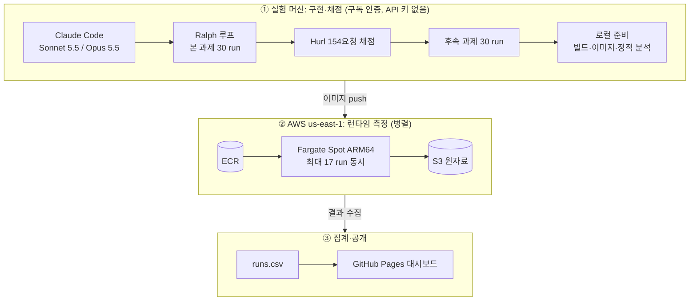
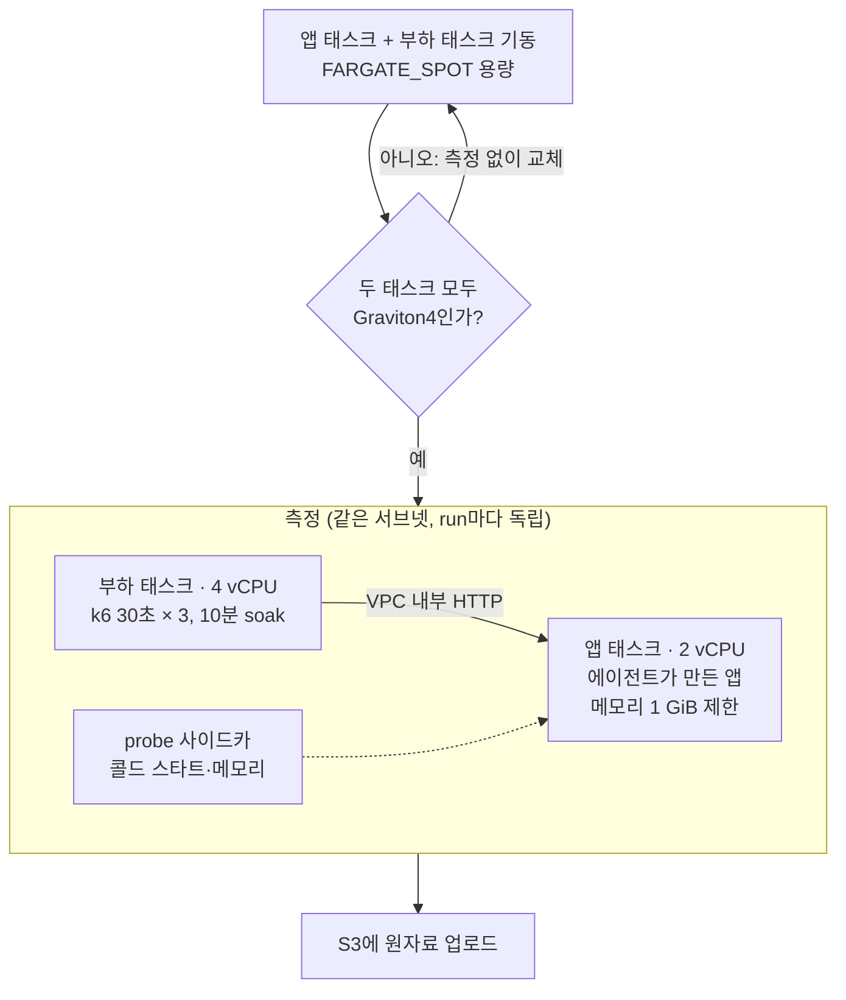

# Language Benchmark

🌐 [English](README.md) · [한국어](README.ko.md) · [日本語](README.ja.md) · [中文](README.zh-CN.md)

이 프로젝트는 **코딩 에이전트(Claude Code)가 같은 RealWorld 백엔드를 TypeScript, Python, Go, Rust, C++로 구현한 결과를 비교해, 바이브 코딩 백엔드에 어떤 언어가 적합한지 판단한다.** 언어 런타임 자체의 순수 성능 벤치마크가 아니다. 측정 대상은 에이전트가 만든 코드이므로 결과에는 언어 특성과 에이전트의 구현 선택이 함께 들어 있다.

**📊 라이브 대시보드**: https://roboco.io/language-benchmark/

## 방법

- **고정 조건**: 모델·하네스는 Claude Code + Sonnet 5.5, Claude Code + Opus 5.5 두 조합이다. 둘 다 Claude 구독 인증으로 실행해 API 키 과금이 없다(아래 "실험 파이프라인" 참조). 과제는 [RealWorld 백엔드](tasks/realworld-backend/)이고 DB는 모든 언어에서 SQLite다.
- **비교 축**: 구현 언어 5종과 언어별 스택(TypeScript Fastify+Prisma, Python FastAPI+SQLAlchemy, Go Gin+GORM, Rust Axum+SQLx, C++ Drogon).
- **만드는 과정 지표**: 구현 속도, 실패 포함 비용(API 단가 환산, 청구액 아님), 반복 횟수, 사람 개입 횟수, 구현 안정성(같은 조건 3회 합격률).
- **결과물 지표**: 런타임 속도(RPS·지연), 메모리(유휴·최대 RSS), 런타임 안정성(에러율·장시간 메모리 증가), 코드량·의존성, 빌드 시간·이미지 크기·콜드 스타트, 의존성 취약점, 유지보수성(기능 추가 후속 과제).
- **합격 조건**: `start.sh`로 띄운 서버와 `Dockerfile`로 빌드한 컨테이너가 모두 Hurl 154요청을 통과해야 한다.
- 규칙과 근거: [설계 문서](docs/superpowers/specs/2026-10-17-language-benchmark-design.md), [실험 품질 규칙](docs/experiment-quality-rules.md), [지표 스키마](analysis/metrics/SCHEMA.md), [로드맵](ROADMAP.md).

자매 리포 [coding-agent-benchmark](https://github.com/roboco-io/coding-agent-benchmark)([대시보드](https://roboco.io/coding-agent-benchmark/))는 언어를 TypeScript로 고정하고 모델·하네스 조합을 비교한다. 이 리포는 그 운영 방식을 그대로 쓰고 비교 축만 언어로 바꿨다.

## 실험 파이프라인: API 과금 없이, 런타임 측정은 병렬로

이 벤치마크는 실험 한 번에 에이전트 run 60개(본 과제 30 + 기능 추가 후속 과제 30)와 런타임 측정 30건을 돌린다. 그대로 하면 비용과 시간이 커지므로 두 가지 방식으로 줄였다. 에이전트 구현은 Claude 구독 인증으로 실행해 API 키 과금을 없앴고, 런타임 측정은 AWS Fargate Spot 태스크 여러 개에서 동시에 돌려 대기 시간을 줄였다.

### 구독 인증으로 API 비용 0

에이전트 run은 모두 Claude Code를 구독 인증으로 실행했다. 실행 전 스모크 테스트에서 `apiKeySource: none`을 확인해 API 키가 쓰이지 않음을 검증했다. 이 실험에서 API 키 기준으로 청구된 금액은 없다. 대시보드와 보고서의 `cost_usd`는 토큰 사용량에 공개 API 단가를 곱한 **API 정가 환산 추정치**다. 언어 간 비용을 같은 기준으로 비교하려고 계산한 값이며 실제 청구액이 아니다. EXP-001 전체(Phase 0·본 과제·후속 과제)의 환산 추정 누계는 $40.39였다. 구독에는 사용 한도가 있으므로 하네스는 한도에 걸린 run을 보류한 뒤 처음부터 다시 실행하도록 만들었다. EXP-001에서는 한도에 한 번도 닿지 않았다.

### Fargate Spot 병렬 측정으로 시간 단축

사전 등록 설계는 실험 머신의 로컬 Docker에서 run 하나씩 순차로 측정하는 방식이었다. 이 방식은 run당 약 13분이 걸려 30 run에 약 6.5시간이 필요했다. 실험자 결정으로 측정 환경을 Fargate Spot으로 옮겼고, run마다 독립된 태스크 쌍을 띄워 동시에 측정했다. 그 결과 로컬 준비와 네트워크 오류로 인한 6 run 재측정까지 포함해 16:31부터 17:47까지 약 1시간 16분 만에 30 run을 끝냈다. 동시에 측정한 run은 최대 17개였다.

| 항목 | 로컬 Docker 순차 측정 (원래 설계) | Fargate Spot 병렬 측정 (실제) |
|------|------|------|
| 30 run 측정 시간 | 약 6.5시간 (run당 약 13분 × 30, 추정) | 약 1시간 16분 (실측, 재측정 포함) |
| 동시 측정 | 1 run | 최대 17 run |
| run 간 간섭 | 순차 실행으로 회피 | 태스크마다 자원이 분리됨 |
| 하드웨어 | 실험 머신 (Mac) | Graviton4만 사용 (30/30 확인) |

비용은 측정 태스크가 실제로 돈 시간으로 추정했다. 30 run의 측정 시도 32회는 앱·부하 태스크 쌍 기준 합계 약 7.7시간이다. 여기에 ARM Fargate 온디맨드 단가(vCPU당 시간 $0.03238, GB당 시간 $0.00356, us-east-1, AWS Pricing API 2026-10-18 조회)를 적용하면 약 $1.82다. Spot 단가는 온디맨드보다 낮으므로 실제 측정 비용은 이 값보다 작다. 이 추정에는 CPU 세대가 맞지 않아 측정 전에 교체한 태스크와 ECR·S3 비용이 빠져 있다. 실제 청구액은 아직 확인하지 않았다.

Fargate는 태스크가 놓일 CPU 세대를 보장하지 않는다. 시험으로 태스크 15개를 띄웠을 때 Graviton4가 10개, Graviton2가 3개, Graviton3가 2개였다. 세대가 섞이면 언어 차이에 하드웨어 차이가 섞인다. 그래서 측정 전에 두 태스크가 모두 Graviton4인지 확인하고, 아니면 측정하지 않고 새 태스크로 교체했다. Spot 회수나 기동 실패가 생기면 새 태스크로 다시 측정한다. 측정 스크립트는 [fargate/](experiments/001-five-language-realworld/fargate/)에 있고, 로컬 측정과의 정의 차이와 재측정 이력은 [설계 이탈 기록](experiments/001-five-language-realworld/runs/deviations.md)에 있다.

## 실험 결과

<!-- RESULTS:BEGIN -->
<!-- 이 블록은 scripts/update_readme_results.py가 experiments/*/report.md에서 자동 생성한다. 직접 수정 금지. -->

| 실험 | 가설 | 판정 | 클라이언트 |
|------|------|------|------|
| [EXP-001](experiments/001-five-language-realworld/report.md) 5개 언어 RealWorld 백엔드 Ralph 루프 | L-01: 같은 RealWorld 백엔드 과제에서 바이브 코딩 적합성(만드는 과정 지표와 결과물 지표의 종합 점수)은 구현 언어(TypeScript, Python, Go, Rust, C++) 사이에 차이가 있으며, 그 순위는 Sonnet 5.5와 Opus 5.5에서 같다. | **부분 검증** | Claude Code 2.1.302 |

**EXP-001 — 5개 언어 RealWorld 백엔드 Ralph 루프** (부분 검증)  
언어 간 종합 점수 차이는 관측됐지만(Go는 두 모델 모두 상위 2위, Python은 두 모델 모두 최하위) 1위가 모델마다 달라(Sonnet 5.5 Rust, Opus 5.5 Go) 순위가 같다는 부분은 지지되지 않았고, 30 run 모두 합격해 합격률로는 언어를 구별하지 못했다. → [보고서](experiments/001-five-language-realworld/report.md)

<!-- RESULTS:END -->

### 종합 인사이트

EXP-001(2026-10-18, 5 언어 × Sonnet 5.5·Opus 5.5 × 3회)에서 RealWorld 백엔드는 다섯 언어 모두 두 모델에서 30/30 합격했고 29건이 첫 iteration에 끝났다. 따라서 이 과제 수준에서는 언어가 완주 가능성을 가르지 않았고, 차이는 구현 비용·시간과 결과물의 런타임 특성에서 나타났다.

24개 지표 균등 가중 종합 점수에서 Go는 두 모델 모두 상위 2위 안(Sonnet 2위, Opus 1위)이었고 Python은 두 모델 모두 최하위였다. 1위는 모델마다 달랐다(Sonnet Rust, Opus Go). C++은 구현 시간과 비용이 가장 컸지만 메모리 사용이 가장 작았고, Python·TypeScript는 구현은 빠르고 싸지만 처리량·이미지 크기·취약점 수에서 뒤졌다. Opus 5.5는 Sonnet 5.5보다 추정 비용이 약 2배, 구현 시간이 약 1.8배였고 본 과제 합격률 이득은 없었다.

한계: 과제 하나, 셀당 3회이며 종합 점수는 가중치 선택에 민감하다. 런타임 지표는 AWS Fargate Spot(Graviton4, 2 vCPU)에서 측정했다. 자세한 근거는 [EXP-001 보고](experiments/001-five-language-realworld/report.md)에 있다.
