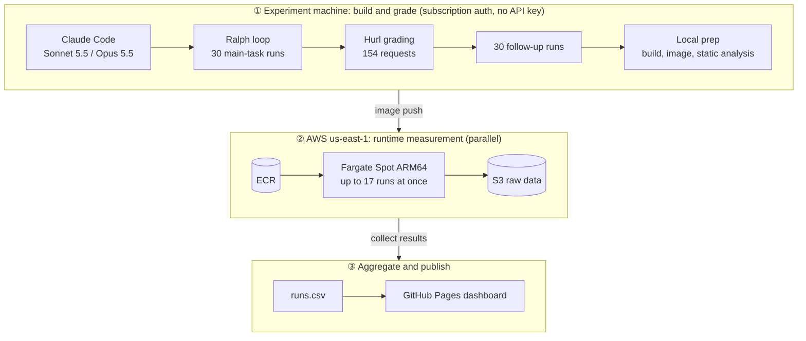
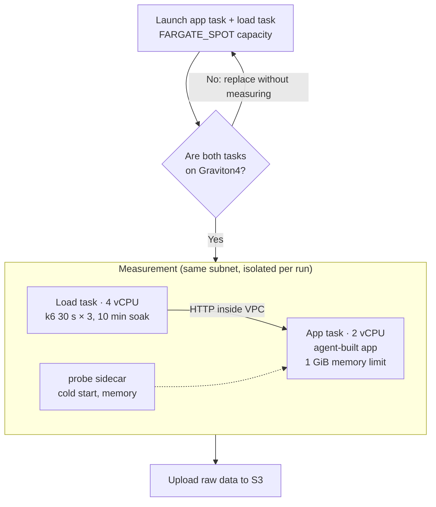

# Language Benchmark

🌐 [English](README.md) · [한국어](README.ko.md) · [日本語](README.ja.md) · [中文](README.zh-CN.md)

This project **compares how a coding agent (Claude Code) implements the same RealWorld backend in TypeScript, Python, Go, Rust and C++, to judge which language suits vibe-coded backends.** It is not a raw language-runtime benchmark. What we measure is code the agent wrote, so results mix language traits with the agent's implementation choices.

**📊 Live dashboard**: https://roboco.io/language-benchmark/

## Methodology

- **Fixed**: two model–harness combinations, Claude Code + Sonnet 5.5 and Claude Code + Opus 5.5, both run with Claude subscription authentication, so there are no API key charges (see "Experiment pipeline" below). The task is the [RealWorld backend](tasks/realworld-backend/); the database is SQLite in every language.
- **Compared**: five implementation languages with one stack each (TypeScript Fastify+Prisma, Python FastAPI+SQLAlchemy, Go Gin+GORM, Rust Axum+SQLx, C++ Drogon).
- **Build-process metrics**: implementation time, cost including failures (API-price equivalent, not billed spend), iterations, human interventions, implementation stability (pass rate over 3 runs).
- **Product metrics**: runtime speed (RPS, latency), memory (idle and peak RSS), runtime stability (error rate, memory growth under soak), code size and dependencies, build time, image size and cold start, dependency vulnerabilities, maintainability (a follow-up feature task).
- **Pass condition**: both the server started by `start.sh` and the container built from `Dockerfile` must pass all 154 Hurl requests.
- Rules and evidence: [design](docs/superpowers/specs/2026-10-17-language-benchmark-design.md), [quality rules](docs/experiment-quality-rules.md) (Korean), [metric schema](analysis/metrics/SCHEMA.md), [roadmap](ROADMAP.md).

The sister repo [coding-agent-benchmark](https://github.com/roboco-io/coding-agent-benchmark) fixes the language to TypeScript and compares model–harness combinations. This repo reuses its operating model and swaps the comparison axis to language.

## Experiment pipeline: no API charges, parallel runtime measurement

One experiment runs 60 agent runs (30 main-task runs and 30 follow-up feature runs) and 30 runtime measurements. Done naively, this costs money and takes a long time, so we cut both in two ways. The agent runs use Claude subscription authentication, which removes API key charges. The runtime measurements run at the same time on many AWS Fargate Spot tasks, which cuts the wait.

### Subscription authentication: zero API charges

Every agent run used Claude Code with subscription authentication. A smoke test before the experiment confirmed `apiKeySource: none`, so no API key was used, and no API key charges were billed for this experiment. The `cost_usd` values in the dashboard and reports are **API-price-equivalent estimates**: token usage multiplied by public API prices. We compute them only to compare languages on the same basis; they are not billed amounts. The estimated total for all of EXP-001 (Phase 0, main task and follow-up) was $40.39. Subscriptions have usage limits, so the harness puts a run that hits the limit on hold and re-runs it from the start. EXP-001 never reached the limit.

### Parallel Fargate Spot measurement: shorter wall time

The pre-registered design measured runs one at a time in local Docker on the experiment machine. That takes about 13 minutes per run, or about 6.5 hours for 30 runs. The experimenter decided to move measurement to Fargate Spot, where each run gets its own pair of tasks and runs measure at the same time. All 30 runs finished in about 1 hour 16 minutes (16:31 to 17:47), including local prep and re-measurement of 6 runs after network errors. Up to 17 runs were measured at once.

| Item | Local Docker, sequential (original design) | Fargate Spot, parallel (actual) |
|------|------|------|
| Time to measure 30 runs | About 6.5 h (about 13 min × 30, estimate) | About 1 h 16 min (observed, including re-runs) |
| Runs measured at once | 1 | Up to 17 |
| Interference between runs | Avoided by running one at a time | Each task has its own resources |
| Hardware | Experiment machine (Mac) | Graviton4 only (confirmed 30/30) |

We estimate the cost from the time the measurement tasks actually ran. The 32 measurement attempts for 30 runs add up to about 7.7 hours of app-and-load task pairs. At ARM Fargate on-demand prices ($0.03238 per vCPU-hour and $0.00356 per GB-hour in us-east-1, from the AWS Pricing API on 2026-10-18), that is about $1.82. Spot prices are lower than on-demand, so the real measurement cost is below this figure. The estimate leaves out tasks that were replaced before measuring because of the wrong CPU generation, and ECR and S3 costs. We have not checked the actual bill yet.

Fargate does not guarantee the CPU generation a task lands on. When we launched 15 trial tasks, 10 were Graviton4, 3 were Graviton2 and 2 were Graviton3. Mixed generations would mix hardware differences into language differences. So before measuring, the orchestrator checks that both tasks are on Graviton4; if not, it replaces them without measuring. A Spot interruption or launch failure is measured again on a new task. The scripts are in [fargate/](experiments/001-five-language-realworld/fargate/). The definitions that differ from local measurement and the re-measurement history are in the [deviation log](experiments/001-five-language-realworld/runs/deviations.md).

## Results

<!-- RESULTS:BEGIN -->
<!-- This block is generated by scripts/update_readme_results.py from experiments/*/report.md (translations from scripts/readme_i18n.json). Do not edit by hand. -->

| Experiment | Hypothesis | Verdict | Client |
|------|------|------|------|
| [EXP-001](experiments/001-five-language-realworld/report.md) Five-language RealWorld backend Ralph loop | L-01: On the same RealWorld backend task, vibe-coding suitability (a composite of process and output metrics) differs across implementation languages (TypeScript, Python, Go, Rust, C++), and the ranking is the same for Sonnet 5.5 and Opus 5.5. | **Partially supported** | Claude Code 2.1.302 |

**EXP-001 — Five-language RealWorld backend Ralph loop** (Partially supported)  
Composite scores differed by language (Go placed top two and Python last under both models), but the top language differed by model (Sonnet 5.5: Rust, Opus 5.5: Go), so the same-ranking part was not supported; all 30 runs passed, so pass rate did not separate languages. → [report](experiments/001-five-language-realworld/report.md)

<!-- RESULTS:END -->

### Overall insights

In EXP-001 (2026-10-18, 5 languages × Sonnet 5.5 and Opus 5.5 × 3 reps), every language passed the RealWorld backend task under both models (30/30), and 29 runs finished on the first iteration. At this task difficulty, language did not decide whether the agent could finish; the differences appeared in build cost and time and in the runtime characteristics of the result.

On the composite score (24 metrics, equal weights), Go placed in the top two under both models (Sonnet 2nd, Opus 1st) and Python placed last under both. The top language differed by model (Sonnet: Rust, Opus: Go). C++ took the most time and cost to build but used the least memory; Python and TypeScript were fast and cheap to build but trailed on throughput, image size, and vulnerability count. Opus 5.5 cost about 2× and took about 1.8× as long as Sonnet 5.5, with no pass-rate gain on this task.

Limits: one task, 3 runs per cell, and the composite score is sensitive to weights. Runtime metrics were measured on AWS Fargate Spot (Graviton4, 2 vCPU). See the [EXP-001 report](experiments/001-five-language-realworld/report.md) for the evidence.
