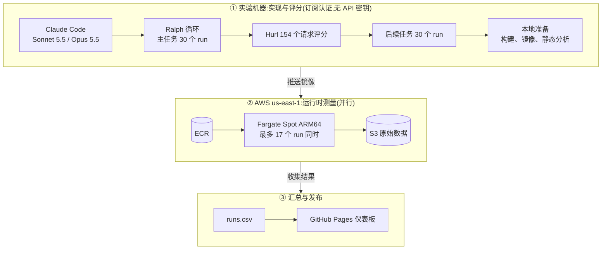
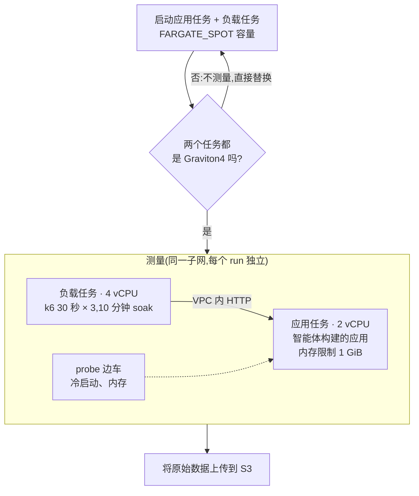

# Language Benchmark

🌐 [English](README.md) · [한국어](README.ko.md) · [日本語](README.ja.md) · [中文](README.zh-CN.md)

本项目**比较编码智能体(Claude Code)用 TypeScript、Python、Go、Rust、C++ 实现同一个 RealWorld 后端的结果,以判断哪种语言最适合氛围编程(vibe coding)后端。** 这不是语言运行时本身的纯性能基准测试。测量对象是智能体编写的代码,因此结果中同时包含语言特性和智能体的实现选择。

**📊 实时仪表盘**: https://roboco.io/language-benchmark/

## 方法

- **固定条件**: 模型与工具组合为 Claude Code + Sonnet 5.5 和 Claude Code + Opus 5.5,两者都以 Claude 订阅认证运行,没有 API 密钥计费(见下文"实验流水线")。任务为 [RealWorld 后端](tasks/realworld-backend/),所有语言都使用 SQLite 数据库。
- **比较维度**: 5 种实现语言及各自的技术栈(TypeScript Fastify+Prisma、Python FastAPI+SQLAlchemy、Go Gin+GORM、Rust Axum+SQLx、C++ Drogon)。
- **构建过程指标**: 实现时间、含失败的成本(按 API 单价换算,非实际账单)、迭代次数、人工介入次数、实现稳定性(同条件 3 次的通过率)。
- **产出物指标**: 运行速度(RPS、延迟)、内存(空闲与峰值 RSS)、运行稳定性(错误率、长时间负载下的内存增长)、代码量与依赖数、构建时间、镜像大小与冷启动、依赖漏洞、可维护性(新增功能的后续任务)。
- **通过条件**: 由 `start.sh` 启动的服务器和由 `Dockerfile` 构建的容器都必须通过全部 154 个 Hurl 请求。
- 规则与依据: [设计文档](docs/superpowers/specs/2026-10-17-language-benchmark-design.md)、[实验质量规则](docs/experiment-quality-rules.md)(韩语)、[指标定义](analysis/metrics/SCHEMA.md)、[路线图](ROADMAP.md)。

姊妹仓库 [coding-agent-benchmark](https://github.com/roboco-io/coding-agent-benchmark)([仪表板](https://roboco.io/coding-agent-benchmark/))将语言固定为 TypeScript,比较模型与工具组合。本仓库沿用其运作方式,只把比较维度换成语言。

## 实验流水线:无 API 计费,运行时测量并行进行

一次实验要运行 60 个智能体 run(主任务 30 个 + 功能追加后续任务 30 个)和 30 次运行时测量。直接执行会花费较多费用和时间,因此我们用两种方式加以削减。智能体实现使用 Claude 订阅认证运行,从而没有 API 密钥计费。运行时测量在多个 AWS Fargate Spot 任务上同时进行,从而缩短等待时间。

### 订阅认证:API 费用为 0

所有智能体 run 都以订阅认证方式运行 Claude Code。实验前的冒烟测试确认了 `apiKeySource: none`,验证没有使用 API 密钥。本实验没有产生任何 API 密钥计费。仪表板和报告中的 `cost_usd` 是用 token 用量乘以公开 API 单价得到的 **API 价格换算估算值**。计算它只是为了在同一基准上比较各语言的成本,并非实际账单金额。EXP-001 全部(Phase 0、主任务、后续任务)的换算估算累计为 $40.39。订阅有使用上限,因此测试框架会把触及上限的 run 挂起,并从头重新运行。EXP-001 从未触及上限。

### Fargate Spot 并行测量:缩短时间

预注册设计是在实验机器的本地 Docker 中逐个顺序测量 run。这种方式每个 run 约需 13 分钟,30 个 run 约需 6.5 小时。实验者决定把测量环境迁移到 Fargate Spot,为每个 run 启动独立的任务对并同时测量。结果是包括本地准备和因网络错误重新测量的 6 个 run 在内,从 16:31 到 17:47 约 1 小时 16 分钟完成了 30 个 run。同时测量的 run 最多为 17 个。

| 项目 | 本地 Docker 顺序测量(原设计) | Fargate Spot 并行测量(实际) |
|------|------|------|
| 测量 30 个 run 的时间 | 约 6.5 小时(每个 run 约 13 分钟 × 30,估算) | 约 1 小时 16 分钟(实测,含重新测量) |
| 同时测量 | 1 个 run | 最多 17 个 run |
| run 之间的干扰 | 通过顺序执行避免 | 每个任务的资源相互隔离 |
| 硬件 | 实验机器(Mac) | 仅使用 Graviton4(已确认 30/30) |

费用根据测量任务实际运行的时间估算。30 个 run 的 32 次测量尝试,按应用与负载任务对计算合计约 7.7 小时。按 ARM Fargate 按需单价(每 vCPU 小时 $0.03238、每 GB 小时 $0.00356,us-east-1,2026-10-18 通过 AWS Pricing API 查询)计算约为 $1.82。Spot 单价低于按需单价,因此实际测量费用低于该值。该估算不包括因 CPU 代次不符而在测量前替换的任务,也不包括 ECR 和 S3 费用。实际账单尚未核对。

Fargate 不保证任务所在的 CPU 代次。试启动 15 个任务时,Graviton4 有 10 个,Graviton2 有 3 个,Graviton3 有 2 个。代次混杂会让硬件差异混入语言差异。因此在测量前确认两个任务都是 Graviton4,否则不测量并替换为新任务。发生 Spot 回收或启动失败时,会在新任务上重新测量。测量脚本位于 [fargate/](experiments/001-five-language-realworld/fargate/),与本地测量的定义差异和重新测量记录见[设计偏差记录](experiments/001-five-language-realworld/runs/deviations.md)。

## 实验结果

<!-- RESULTS:BEGIN -->
<!-- 此区块由 scripts/update_readme_results.py 根据 experiments/*/report.md 自动生成（翻译来自 scripts/readme_i18n.json）。请勿手动编辑。 -->

| 实验 | 假设 | 判定 | 客户端 |
|------|------|------|------|
| [EXP-001](experiments/001-five-language-realworld/report.md) 五种语言 RealWorld 后端 Ralph 循环 | L-01: 在同一个 RealWorld 后端任务中，氛围编程适用性（构建过程指标与产出物指标的综合得分）在实现语言（TypeScript、Python、Go、Rust、C++）之间存在差异，且该排名在 Sonnet 5.5 与 Opus 5.5 中相同。 | **部分验证** | Claude Code 2.1.302 |
| [EXP-002](experiments/002-java-php-csharp/report.md) Java·PHP·C# RealWorld 后端 Ralph 循环 | L-02: 在同一 RealWorld 后端任务上，氛围编程适配度（开发过程指标与产出指标的综合分）在 Java、PHP、C# 之间存在差异，且三种语言内的排名在 Sonnet 5.5 与 Opus 5.5 下相同。 | **支持（探索性）** | Claude Code 2.1.302 |

**EXP-001 — 五种语言 RealWorld 后端 Ralph 循环** (部分验证)  
观察到语言间综合得分差异（Go 在两个模型中均进入前两名，Python 在两个模型中均为最后），但第一名因模型而异（Sonnet 5.5 为 Rust，Opus 5.5 为 Go），因此“排名相同”部分未获支持；30 个 run 全部通过，合格率无法区分语言。 → [报告](experiments/001-five-language-realworld/report.md)

**EXP-002 — Java·PHP·C# RealWorld 后端 Ralph 循环** (支持（探索性）)  
C# 在两个模型下综合分均排第一（Sonnet 0.846，Opus 0.983），且与第二名的各轮重复范围不重叠；Java 与 PHP 的第二、三名在两个模型间互换且范围重叠；18 个 run 全部通过，通过率无法区分语言。这是单一任务、每格 3 次的探索性结果，仅应作为简单参考。 → [报告](experiments/002-java-php-csharp/report.md)

<!-- RESULTS:END -->

### 综合洞察

在 EXP-001（2026-10-18，5 种语言 × Sonnet 5.5、Opus 5.5 × 3 次）中，RealWorld 后端任务在两个模型下五种语言全部通过（30/30），其中 29 个 run 在第一次 iteration 完成。在这一任务难度下，语言并未决定能否完成，差异体现在实现成本、时间以及产出物的运行时特性上。

在 24 项指标等权的综合得分中，Go 在两个模型下都进入前两名（Sonnet 第 2，Opus 第 1），Python 在两个模型下都是最后一名。第一名因模型而异（Sonnet 为 Rust，Opus 为 Go）。C++ 实现时间和成本最高，但内存占用最小；Python、TypeScript 实现快且便宜，但在吞吐量、镜像大小和漏洞数上落后。Opus 5.5 的估算成本约为 Sonnet 5.5 的 2 倍，实现时间约 1.8 倍，在本任务上没有合格率收益。

在 EXP-002（2026-10-19，Java、PHP、C# × 两个模型 × 3 次）中，18 个 run 同样全部在第一次 iteration 通过。在三种语言内的综合得分中，C# 在两个模型下均排第一（Sonnet 0.846，Opus 0.983），且与第二名的各轮重复范围不重叠。C# 的实现时间和成本最低，空闲内存（约 45 MiB）、镜像和依赖数也最小，吞吐量与 Java 同处上游。Java 吞吐量好，但内存、冷启动（约 5 秒）和构建时间最差；PHP 吞吐量最低，且因基础镜像而漏洞数最多。Java 与 PHP 的第二、三名在两个模型间互换。与 EXP-001 合并的 8 种语言比较中 C# 在两个模型下也排第一，但这是执行日期相差一天的探索性比较，且在 Sonnet 下其范围与 Rust、Go 重叠。两个实验都是单一任务、每格 3 次的探索性结果，这些排名只是选择语言的简单参考，并不能证明某种语言普遍更好。

局限：只有一个任务，每格 3 次，综合得分对权重选择敏感。运行时指标在 AWS Fargate Spot（Graviton4，2 vCPU）上测得。依据见 [EXP-001 报告](experiments/001-five-language-realworld/report.md) 和 [EXP-002 报告](experiments/002-java-php-csharp/report.md)。
